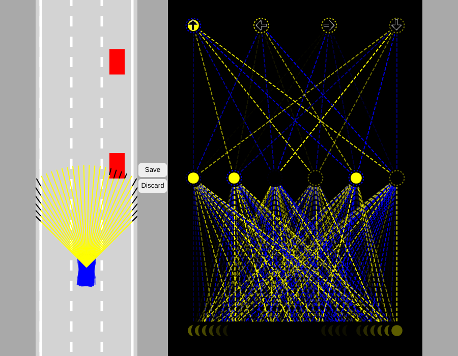

# SelfCar

A 2D self-driving car simulation in plain JavaScript. Each car has a small neural network that reads its distance sensors and decides whether to accelerate, turn, or brake. There's no backprop. Cars learn through a simple genetic approach: run 100 cars at once, save the one that gets furthest, mutate it, and repeat.



*Left: the road, with traffic in red and the AI cars in blue (the leading car is shown solid, with its sensor rays). Right: a live view of the leading car's network.*

## How it works

- **Sensors:** 30 rays fanned across 90° in front of the car. Each ray reports how close the nearest road edge or traffic car is.
- **Network:** a feed-forward net with layers `[30, 6, 4]`. The four outputs map to forward, left, right, and reverse.
- **Training:** 100 AI cars spawn together. The camera follows whichever car is furthest ahead. Press **Save** to store that car's brain in `localStorage`. On reload every car starts from the saved brain, and all except one get mutated (amount 0.1). **Discard** clears the saved brain.
- **Traffic:** 50 dummy cars in random lanes, with slightly different speeds and spacing.

The collision detection uses polygon intersection (line-segment math in `utils.js`). No libraries or physics engine.

## Running it

No build step. Clone the repo and open `index.html` in a browser.

```bash
git clone https://github.com/Ned-Spaniel/SelfCar.git
cd SelfCar
open index.html     # or just double-click it
```

To train: let it run, press **Save** when a car gets far, then refresh. Repeat until the cars get through traffic reliably.

## Files

```
main.js        simulation loop, spawning, save/discard
car.js         car movement, damage, and drawing
sensor.js      ray casting
network.js     neural network and mutation
visualizer.js  draws the network on the right panel
road.js        lanes and borders
controls.js    keyboard / AI / dummy controls
utils.js       lerp and segment intersection
```

## Credit

Built while following Radu Mariescu-Istodor's *Self-Driving Car with JavaScript* course.